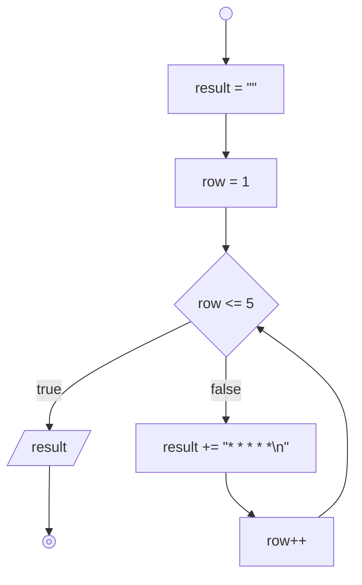
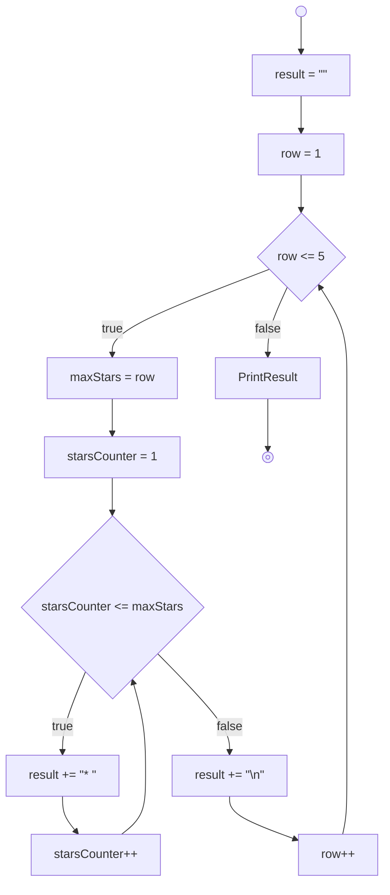
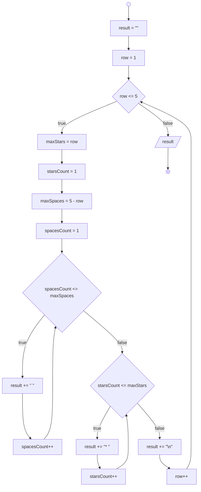
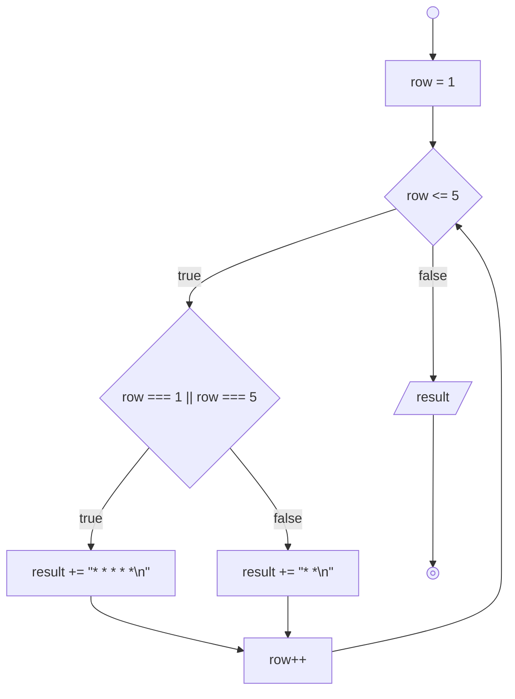

# Javascript 3

## Pola 1: Persegi

```text
* * * * *
* * * * *
* * * * *
* * * * *
* * * * *
```

### Flowchart



## Pattern 2: Segitiga Siku

```text
* 
* * 
* * * 
* * * * 
* * * * * 
```

### Flowchart



## Pola 3: Segitiga Sama Sisi (PR)

```text
    * 
   * * 
  * * * 
 * * * * 
* * * * * 
```

### Flowchart



## Pola 4: Border Bersegi (PR)

```text
* * * * *
*          *
*          *
*          *
* * * * * 
```

### Flowchart


